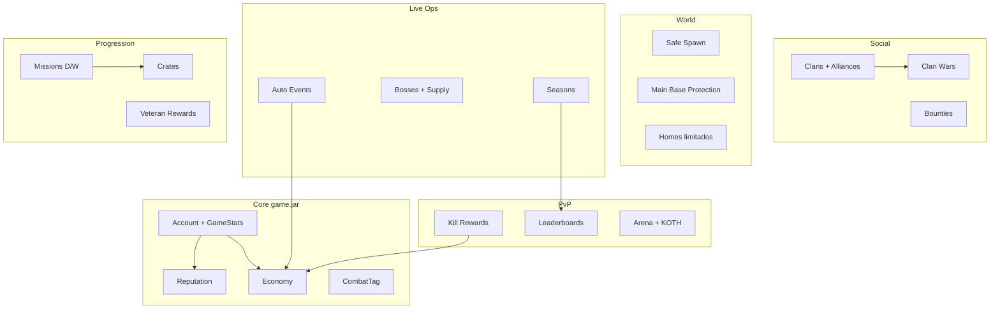

# Savage Semi-Anarquia — Design completo

Documento de game design e arquitetura técnica para o modo **Semi-Anarquia** do `game.jar` (Paper 1.21).  
Objetivo: liberdade de sobrevivência + PvP + economia, **sem** anarquia total — competitivo, viciante e sustentável por meses.

---

## 1. Visão do modo

| Pilar | O que significa no servidor |
|-------|------------------------------|
| **Liberdade** | PvP, roubo de drops, exploração, Nether/End abertos, mundo principal persistente |
| **Limites justos** | Spawn protegido, combat tag, anti-logout, proteção só na base principal |
| **Progressão social** | Clãs, reputação, temporadas, ranking público |
| **Economia skill-based** | Dinheiro por risco (PvP, eventos, missões) — crates e VIP **sem** vantagem de combate |
| **Conteúdo ao vivo** | Eventos automáticos, guerras de clã, bounties, bosses |

**Tom do servidor:** “Você pode morrer e perder loot, mas sempre há um próximo objetivo (base, clã, temporada, recompensa de veterano).”

---

## 2. Estado atual no repositório

| Sistema | Status |
|---------|--------|
| Conta + persistência (SQLite/MySQL) | ✅ Fase 1 |
| Tags, medalhas, prefs, tab/nametag | ✅ Parcial (Fase 2) |
| **Clãs** (GUI, chat `/cc`, DB compartilhado com lobby) | ✅ Implementado |
| PvP, spawn, economia, eventos, homes, proteção | 📋 Este documento + roadmap abaixo |
| Redis cross-server | 🔧 Infra pronta, canais a definir |

---

## 3. Mapa de sistemas (requisito → módulo)



---

## 4. Sistemas detalhados

### 4.1 Clãs — alianças e rivalidades

**Já existe:** criar clã, convites, cargos, cor da tag, ranking por poder, chat `/cc`.

**Extensões:**

| Feature | Regra de negócio |
|---------|------------------|
| **Aliança** | Líder A propõe → líder B aceita. Máx. 2 alianças ativas por clã. Aliados: sem PvP entre membros, `/cc` compartilhado opcional, bloco de friendly fire em eventos de clã |
| **Rivalidade** | Declaração mútua ou unilateral (cooldown 24h). +10% recompensa em kill entre rivais; aparece no tab `[⚔]` |
| **Poder do clã** | `+1` por kill válida de membro, `+5` vitória em guerra, `+2` captura KOTH. Decai 1%/semana sem atividade (mínimo 50% do pico) |
| **Guerra** | Ver §4.15 |

**Comandos:** `/clan alianca|rival|guerra|poder`

**Dados:** estender JSON do clã (`alliances[]`, `rivals[]`, `warState`).

---

### 4.2 PvP — fora de áreas protegidas

| Zona | PvP | Notas |
|------|-----|-------|
| Spawn (raio configurável, ex. 50 blocos) | ❌ | `spawn-protection-radius` no `config.yml` |
| Arena de eventos | ✅ só participantes | Instância ou região WorldGuard |
| Base principal (protegida) | ❌ | Ver §4.8 |
| Mundo overworld / Nether / End | ✅ | End/Nether liberados (`allow-end`, `allow-nether`) |
| Aliados de clã | ❌ | Flag opcional em mundo principal |

**Kill válida:** vítima em combat tag ou atacou o killer nos últimos 30s; sem aliados; fora de spawn; anti-farm (mesma vítima 3x em 10 min = 0 recompensa).

---

### 4.3 Spawn protegido — NPCs, loja, warps

**Spawn = hub de sobrevivência**, não lobby de minigame.

| Elemento | Função |
|----------|--------|
| NPC Mercador | Vende comida, blocos básicos, cordas — preços 20% acima do mercado player |
| NPC Ferreiro | Repara itens, converte drops de evento |
| NPC Guia de missões | Abre GUI missões diárias/semanais |
| NPC Ranking | Top kills, KDR, clãs, temporada |
| NPC Eventos | Próximo KOTH/Arena/Drop com countdown |
| Warps | `/warp loja`, `arena`, `mineracao`, `pvp` (cooldown 5s, cancela em combat) |

**Proteções no spawn:** sem dano, sem quebrar/colocar, sem containers de outros, sem `/home` set aqui.

**Implementação:** reutilizar padrão `lobbyhost` (NPC Display 1.21) ou Citizens; região com flag `pvp=deny`.

---

### 4.4 Recompensas por kill

Fórmula base (configurável):

```
recompensa = baseKill + (victimStreak * 2) + reputationBonus - antiFarmPenalty
```

| Parâmetro | Valor sugerido |
|-----------|----------------|
| `baseKill` | $150–300 |
| Bônus streak vítima (3+ kills sem morrer) | +$50 por nível, cap +$200 |
| Bônus reputação (matar Bandido sendo Herói) | +15% |
| Penalidade (matar Neutro/Herói como Bandido) | -20% rep, -10% dinheiro |
| Drop extra | 5% chance fragmento “Troféu de Sangue” (craft cosmético ou troca) |

Anunciar no chat global apenas kills com streak ≥ 5 ou bounty concluída.

---

### 4.5 Ranking — kills, deaths, KDR

**Persistir em `GameStats`** (novo objeto no `AccountContext` ou tabela `player_stats`):

| Campo | Uso |
|-------|-----|
| `kills`, `deaths` | Lifetime + temporada |
| `kdr` | Calculado; mínimo 10 kills para entrar no top KDR |
| `killStreak`, `bestStreak` | Sessão / recorde |
| `lastKillAt` | Anti-farm |

**Leaderboards:** holograma no spawn + `/top kills|deaths|kdr|clans|season` + PlaceholderAPI `%game_kills%`, etc.

Atualização: async a cada kill; Redis pub/sub para sync holograma entre reinícios.

---

### 4.6 Eventos automáticos

Scheduler (`events.auto-schedule: true`) com fila ponderada:

| Evento | Duração | Recompensa principal |
|--------|---------|------------------------|
| **KOTH** | 10 min captura | Dinheiro + tag temporária + 1 chave evento |
| **Arena PvP** | 15 min FFA | Top 3: dinheiro + itens cosméticos |
| **Boss mundial** | até morte | Drops raros + XP clã |
| **Supply Drop** | 5 min após pouso | Crate tier 2–3 no chão, PvP na zona do drop |

**Cadência sugerida (servidor médio):**

- KOTH: a cada 90 min  
- Arena: a cada 120 min  
- Supply: a cada 60 min  
- Boss: 2× por dia (horários de pico)

Anúncio: 5 min antes (`announce-minutes-before`), título + som + coordenadas aproximadas (±50 blocos).

**Itens raros:** só dropam em evento/boss/guerra — nunca em crate comum.

---

### 4.7 Bounties (caçadas)

| Ação | Regra |
|------|-------|
| Colocar bounty | `/bounty add <jogador> <valor>` — mín. $500, taxa 10% |
| Pool | Acumula se vários colocarem no mesmo alvo |
| Reivindicar | Kill válida; pagamento automático; anúncio global |
| Offline | Bounty permanece; expira em 7 dias se alvo inativo |

**Integração clã:** bounty em líder rival = bônus +5% poder de clã para o caçador.

---

### 4.8 Economia — dinheiro e trocas

**Moeda:** `$` (campo `golds` no contexto ou wallet dedicado).

| Fonte | Sink |
|-------|------|
| Kills, eventos, missões, venda `/shop` | `/shop` compras, bounty tax, repair, claim expansão |
| Player `/pay` | Imposto 2% em transferências > $10k |
| Clã (guerra apostada) | Homes extras, rename clã |

**Trocas player:** `/trade <jogador>` — GUI segura (ambos confirmam, anti-dupe).

**Mercado NPC spawn:** preços fixos altos — incentiva economia player-driven depois.

**Anti-inflação:** imposto diário 0.1% acima de $100k (soft cap); eventos são principal fonte de itens raros, não de dinheiro infinito.

---

### 4.9 Homes — limitados

| Rank / permissão | Homes |
|------------------|-------|
| Default | 1 |
| VIP | 2 |
| MVP | 3 |
| Clã (upgrade) | +1 compartilhado “clan home” (só líder seta) |

Cooldown `/home`: 30s base, 15s VIP. **Cancela** em combat tag.  
Não setar home em spawn, arena, ou território inimigo protegido.

---

### 4.10 Proteção de terrenos — só base principal

**Filosofia:** farm/outposts = sem proteção (risco real). Uma **base principal** por jogador (ou por clã).

| Parâmetro | Valor sugerido |
|-----------|----------------|
| Tamanho inicial | 25×25 (chunk único ou 2×2 chunks) |
| Expansão | +1 chunk por $50k (máx. 5×5 chunks) |
| Altura | Y 0–256 |
| Offline | Proteção enfraquece após 7 dias offline (opcional: raid weekend) |

**Comandos:** `/base claim|unclaim|trust|untrust|info`  
**Clã:** líder vincula base do clã; membros `trust` automático.

Integração: WorldGuard ou engine própria com SQLite (`claims` table).

---

### 4.11 Combat tag + anti-logout

| Regra | Valor |
|-------|-------|
| Duração tag | 15s (`combat-tag-seconds`) |
| Ação ao sair em tag | Morte simulada + drop inventário + mensagem pública |
| Ender pearl / chorus | Cooldown +1s durante tag |
| `/spawn`, `/home` | Bloqueados |
| Indicador | Actionbar `⚔ Combate (12s)` + partículas vermelhas |

PvE não aplica tag (exceto boss marcado).

---

### 4.12 Reputação — Bandido, Neutro, Herói

Eixo `-100` … `+100` (Neutro = -19 … +19).

| Ação | Δ rep |
|------|-------|
| Kill jogador Neutro | -8 |
| Kill Bandido | +5 |
| Kill Herói | -15 |
| Entregar bounty em Bandido | +3 |
| Missão “ajudar novato” | +2 |
| Roubar container (se detectado) | -5 |

**Efeitos:**

| Faixa | Título | Efeito |
|-------|--------|--------|
| Herói (+20+) | `[Herói]` | -5% preço spawn shop; +5% kill reward vs Bandido |
| Neutro | — | baseline |
| Bandido (-20-) | `[Bandido]` | +5% kill reward; NPC spawn cobra +10%; alguns warps bloqueados |

Recuperação: missões de redenção semanais (+10 rep cap).

---

### 4.13 Guerra entre clãs

**Fluxo:**

1. Líder desafia → aposta mínima $10k (cada lado deposita)  
2. Aceite em 24h → janela de guerra 2h  
3. Vitória: mais kills válidas **ou** destruição do “núcleo” (wither skull placeholder)  
4. Vencedor leva 80% do pote + item exclusivo temporada + poder de clã  

**Exclusivos de guerra:** banner custom, partícula de vitória, 7 dias de tag `[Vencedor]`.

Cooldown entre guerras do mesmo par: 3 dias.

---

### 4.14 Mundo principal, Nether e End

- **Overworld:** sem reset programado; wipe só em temporada anunciada (6–9 meses).  
- **Nether/End:** liberados; portals naturais; limite soft de entidades por chunk em End.  
- **Recursos:** minérios vanilla; minério “sazonal” só em evento (ex. `Savage Ore` → lingote para craft PvP cosmético).

---

### 4.15 Temporadas e ranking

| Elemento | Descrição |
|----------|-----------|
| Duração | 8–12 semanas |
| Reset parcial | Stats de temporada + leaderboard; **não** apaga bases nem dinheiro acumulado (ou wipe opcional de economia top 1%) |
| Pontos temporada | Kills + eventos + guerra + missões semanais |
| Recompensas | Tiers Bronze/Prata/Ouro/Diamante — cosméticos, tags, chaves crate **sem** arma pay-to-win |
| Hall da fama | NPC + placa com nick dos campeões por temporada |

`SeasonContext` no account: `seasonId`, `points`, `tier`, `rewardsClaimed[]`.

---

### 4.16 Missões diárias e semanais

**Diárias (3 slots, reroll 1× com $1k):**

- Matar 5 mobs em Nether  
- Minerar 64 ferro  
- Participar de 1 evento  
- Kill PvP válida (1×)  
- Entregar 32 trigo no NPC  

**Semanais (1 grande + 2 médias):**

- Vitória ou top 3 em Arena  
- 10 kills válidas (cap anti-farm)  
- Contribuir 500 “poder” ao clã via eventos  
- Explorar 3 estruturas diferentes (advancement-like)  

Recompensa: dinheiro, rep, chaves, XP de “passe de temporada” (ver §5).

---

### 4.17 Crates — equilibradas, sem Pay-to-Win

| Tier | Obtida por | Conteúdo |
|------|------------|----------|
| Comum | Missões, playtime | Blocos decorativos, comida, $ |
| Rara | Eventos, KOTH | Cosméticos, pets visuais, boost XP temporada |
| Épica | Boss, temporada Ouro+ | Tag animada, aura, título — **zero** arma/armadura encantada P2W |
| Lendária | Guerra de clã vencedora | 1 item exclusivo temporada (só cosmético ou ferramenta sem encantos de combate) |

**VIP:** +1 reroll missão, +1 home, fila prioritária — **nunca** dano, armadura, ou keys lendárias diretas.

Tabela de loot publicada no Discord (transparência).

---

## 5. Progressão de longo prazo (retenção meses+)

### 5.1 Passe de temporada (free + premium cosmético)

- 50 níveis por temporada; XP por missão, evento, playtime (cap diário).  
- Trilha free: dinheiro, chaves comuns, partículas.  
- Premium (cosmético only): skin de armadura visual, emote, moldura de perfil.

### 5.2 Árvore de “sobrevivente”

Desbloqueios permanentes (não power):

| Nível conta | Desbloqueio |
|-------------|-------------|
| 50 kills | `/near` reduzido |
| 100 eventos | Cor extra clantag |
| 30 dias jogados | 2º slot missão semanal |
| Clã poder 500 | Warp `clan` |

### 5.3 Metas de construção

- **Marco de base:** registrar base → screenshot opcional → recompensa cosmética + entrada em “Base da semana”.  
- **Megaprojetos:** staff/community vote → buff temporário de loja clã.

### 5.4 Calendário vivo

| Semana | Foco |
|--------|------|
| 1 | Exploração (+ Supply Drops) |
| 2 | PvP Arena |
| 3 | Guerra de clãs |
| 4 | Boss + economia (leilão player) |

### 5.5 Recompensas de veterano

| Tempo / marco | Recompensa |
|---------------|------------|
| 30 dias | Tag `[Veterano]` + partícula login |
| 90 dias | 1 chave épica garantida / temporada |
| 365 dias | Título exclusivo + NPC com nome no hall |
| 5 temporadas jogadas | Aura permanente “Lenda” |
| Fundador (pré-launch) | Número de fundador no tab (cosmético) |

Tudo rastreado em `AccountContext.veteranTier` + `firstJoin`.

---

## 6. Incentivos por estilo de jogo

| Estilo | Ganchos |
|--------|---------|
| **PvP** | Bounties, rivalidades, arena, kill streak, guerra, itens raros PvP-only |
| **Exploração** | Supply drops, boss, minério sazonal, missões de estrutura, End race |
| **Construção** | Base protegida única, concurso de bases, clan home, decorates de crate |
| **Social/economia** | Trade, leilão `/ah`, clã, alianças, mercado player (futuro) |

---

## 7. Arquitetura técnica no `game.jar`

Pacotes sugeridos:

```
com.minecraft.game/
├── api/
│   ├── clan/          ✅ existente
│   ├── combat/        CombatTagService, AntiLogout
│   ├── economy/       Wallet, Tax, Trade
│   ├── reputation/    ReputationService
│   ├── stats/         GameStats, Leaderboard
│   ├── bounty/
│   ├── season/
│   ├── mission/
│   ├── event/         Koth, Arena, Boss, Supply
│   ├── claim/         Base protection
│   └── crate/
├── backend/data/      *Data.java por domínio
└── bukkit/
    ├── command/single/
    ├── listener/
    ├── menu/
    └── manager/       EventScheduler, SeasonManager
```

**Novos campos `AccountContext` (resumo):**

```java
// gameStats, reputation, season, missions, combat — Gson-safe
private GameStats stats = new GameStats();
private int reputation = 0;
private SeasonProgress season = new SeasonProgress();
private MissionProgress missions = new MissionProgress();
private VeteranMeta veteran = new VeteranMeta();
```

**Redis (quando `redis.enabled`):**

| Canal | Payload |
|-------|---------|
| `game-stats-update` | uuid, kills, deaths |
| `game-event-announce` | tipo, coords, tempo |
| `clan-war-update` | clanId, state |
| `bounty-complete` | killer, victim, amount |

---

## 8. Roadmap de implementação (prioridade)

| Fase | Entrega | Estimativa relativa |
|------|---------|---------------------|
| **A** ✅ | Clãs base + sync lobby | Feito |
| **B** | Combat tag + anti-logout + spawn protection | 1 sprint |
| **C** | GameStats + kill rewards + `/top` | 1 sprint |
| **D** | Economia (`/pay`, `/balance`, trade) + bounties | 1–2 sprints |
| **E** | Homes limitados + `/base` claim | 1–2 sprints |
| **F** | Reputação + efeitos em kill reward | 1 sprint |
| **G** | Event scheduler (KOTH → Arena → Supply → Boss) | 2–3 sprints |
| **H** | Missões D/W + crates (loot tables YAML) | 2 sprints |
| **I** | Alianças/rivalidades + guerra de clã | 2 sprints |
| **J** | Temporadas + passe + veteranos | 2 sprints |
| **K** | Spawn NPCs + warps + hologramas PAPI | 1 sprint |

Ordem recomendada: **B → C → D → E → F → G** (jogável cedo) → resto.

---

## 9. Configuração expandida (`config.yml`)

Blocos a adicionar conforme cada fase:

```yaml
pvp:
  kill-reward-base: 200
  anti-farm-same-victim-minutes: 10
  ally-damage: false

reputation:
  hero-threshold: 20
  bandit-threshold: -20

homes:
  default-max: 1
  cooldown-seconds: 30

claims:
  max-chunks: 4
  expand-cost: 50000

bounties:
  min-amount: 500
  tax-percent: 10
  expire-days: 7

season:
  id: "2026-S1"
  weeks: 10
  reset-stats: true

missions:
  daily-slots: 3
  weekly-reroll-cost: 1000
```

---

## 10. Métricas de sucesso

| KPI | Meta |
|-----|------|
| Retenção D7 | > 35% |
| Tempo médio sessão | > 45 min |
| % jogadores em clã | > 40% após 2 semanas |
| Participação em evento | > 25% online no horário do evento |
| Reports de P2W | 0 itens de combate em crate paga |

---

## 11. Próximo passo no código

Para começar a implementação imediata no repositório, a **Fase B** (combat + spawn) é o melhor ROI:

1. `CombatTagService` + listener de quit/teleport  
2. `RegionService` spawn sphere  
3. Mensagens em `messages.yml`  
4. Comandos admin `/gamecombat` para debug  

Solicite explicitamente *“implementar Fase B”* (ou outra fase) para gerar os arquivos Java.

---

*Documento vivo — alinhado ao `game/README.md` e ao plugin único Paper 1.21.*
